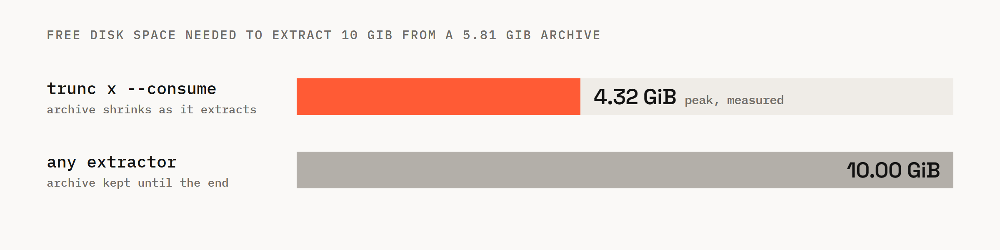

<p align="center">
  <picture>
    <source media="(prefers-color-scheme: dark)" srcset="docs/assets/banner-dark.png">
    
  </picture>
</p>

<p align="center"><b>Unpack archives that are bigger than your free space.</b></p>

<p align="center">
  <a href="https://github.com/Sparsebits/trunc/actions/workflows/ci.yml"></a>
  <a href="#license"></a>
  
  
  
</p>

<p align="center">
  <a href="#install">Install</a> ·
  <a href="#quick-start">Quick start</a> ·
  <a href="#how-it-works">How it works</a> ·
  <a href="#benchmarks">Benchmarks</a> ·
  <a href="#zip-files">ZIP files</a> ·
  <a href="docs/guide.md">User guide</a>
</p>

---

trunc is an archive tool that gives the archive's disk space back while it extracts.

An ordinary extractor keeps the whole archive on disk until it finishes, so turning a 6 GB
archive into 10 GB of files needs 10 GB free. trunc deletes each part of the archive as soon as
the files from that part are safely on disk, so the same job needs a little over 4 GB.

It reads its own `.trnc` format and the ZIP files you already have. If the power goes out
halfway, nothing is lost: run `trunc resume` and it carries on from where it stopped.

## Highlights

- **Less space.** You need about *output size minus archive size* free, not the full output size.
- **Safe to interrupt.** A piece of the archive is deleted only after the files it produced are
  written and flushed to disk.
- **Plans first.** `trunc plan` tells you how much space each mode needs, and warns about cloud-sync
  folders, snapshots and filesystems where destructive extraction is unsafe.
- **Works on ZIP.** Stored and Deflate entries, including Zip64. Very large entries give back
  space while they decompress, not just when they finish.
- **Checks everything.** Every block is hashed, and archives can be signed. Nothing is deleted until
  the output that replaces it has been verified.
- **Fast.** Blocks decompress in parallel at over 1 GiB/s.

## Install

There are no prebuilt releases yet. With Rust 1.85 or newer:

```sh
cargo install --git https://github.com/Sparsebits/trunc trunc-cli
```

This installs a binary called `trunc`.

## Quick start

Pack a folder:

```console
$ trunc create data.trnc ./data
created   data.trnc
entries   12
blocks    96
size      768.00 MiB -> 256.08 MiB (33.3% of original)
time      2.67s (288.09 MiB/s)
```

Before extracting, ask what it will cost:

```console
$ trunc plan data.trnc -C ./out
destination   C:\ NTFS (journaled, cluster 4.00 KiB), 6.54 GiB free
archive now   256.08 MiB
content       768.00 MiB to write

free space needed at the destination:
  extract (keeps archive)     787.89 MiB   fits
  consume (--consume)         531.85 MiB   fits   (peak occupancy 787.93 MiB, 3 batches)
  consume saves 256.03 MiB (32.5%)
```

Then extract it. `--consume` is the destructive part: the archive shrinks as the files appear,
and only a small receipt holding the archive's manifest is left at the end.

```console
$ trunc x data.trnc -C ./out --consume
all blocks consumed; moving files into place
extracted 9 files, 3 directories, 768.00 MiB into ./out
archive   consumed; receipt kept at data.trnc.receipt
time      1.52s (3 batches)
```

The same command works on a ZIP file. Without `--consume`, `trunc x` is an ordinary extractor
and leaves the archive alone.

<details>
<summary><b>More commands</b></summary>

```sh
trunc create data.trnc ./data --codec lz4 --block-size 4M   # faster, larger archive
trunc inspect data.trnc --entries --blocks                  # what's inside
trunc verify data.trnc                                      # check every hash, write nothing
trunc x data.trnc -C ./out --consume --verify-media         # re-read files from disk before deleting
trunc resume data.trnc                                      # continue after a crash or pause

trunc key gen me.key                                        # sign archives
trunc create data.trnc ./data --sign me.key
trunc x data.trnc -C ./out --require-signed --trust-key <public key>
```

Run `trunc <command> --help` for every flag.

</details>

## How it works

Most archive formats put the first file at the start. A `.trnc` archive stores its content
backwards: the first piece sits at the very end of the file. Extraction always works on the
piece at the end:

1. Read the last block, check its hash, and decompress it.
2. Write its files and flush them to disk.
3. Shrink the archive so that block is gone.

```
 archive                                                 output
┌────────┬──────────┬─────────┬─────────┬─────────┐
│ header │ manifest │ block 3 │ block 2 │ block 1 │  ──►  files from block 1
└────────┴──────────┴─────────┴─────────┴─────────┘
                                          ▲
                              cut here once those files are on disk
```

Every filesystem can shrink a file from the end, instantly, and the space comes back right away.
Because a block is cut only after step 2, each byte of your data is always in one of two places:
still in the archive, or already on disk.

The archive's length is the progress marker. After a crash, `trunc resume` looks at how long the
archive is, works out which blocks are gone, and continues with the next one. There is no
separate state file to lose.

Files are written to a hidden folder inside the destination and moved into place at the end, so
a crash never leaves half-written files where you expect finished ones.

## Benchmarks

<p align="center">
  <picture>
    <source media="(prefers-color-scheme: dark)" srcset="docs/assets/chart-dark.png">
    
  </picture>
</p>

A 10 GiB folder was packed with `trunc create --codec lz4` into a 5.81 GiB archive, then
extracted twice on the same NTFS volume: once normally and once with `--consume`. Peak use is the
largest drop in the volume's free space, sampled every 50 ms. The machine has an AMD Ryzen 7 5800H
and a Samsung NVMe SSD.

| Command | Peak disk use | trunc's prediction | Time |
|---|---|---|---|
| `trunc x --consume` | **4.32 GiB** | 4.39 GiB | 53 s |
| `trunc x` | 10.00 GiB | 10.07 GiB | 60 s |

This is one run on one machine, and your results will depend on your data and disk. `trunc plan`
gives the figure for your own archive before you start, and it is meant to overestimate rather
than underestimate.

<details>
<summary><b>Codec speed</b> (1 GiB of test data, three quarters text-like and one quarter random)</summary>

| Codec | Archive size | Create | Extract | Verify |
|---|---|---|---|---|
| zstd:9 (default) | 36.2 % | 295 MiB/s | 1.18 GiB/s | — |
| zstd:3 | 37.6 % | 566 MiB/s | 1.11 GiB/s | 1.6 GiB/s |
| lz4 | 53.1 % | 590 MiB/s | 1.12 GiB/s | 1.6 GiB/s |

</details>

## ZIP files

ZIP files weren't designed to be taken apart from the end, so trunc does more work before it
deletes anything:

1. It reads the ZIP's index and checks every entry against it. It refuses archives whose entries
   overlap, a trick used by zip bombs, unless you pass `--allow-overlap`.
2. It decompresses every entry once and checks its CRC.
3. It saves the ZIP's layout to a small journal next to the archive. The index lives at the end
   of the ZIP, so it is the first thing to go.
4. It extracts entries from the end of the file to the start, shrinking the archive after each one.

A single 50 GB entry would normally need 50 GB of headroom, because the archive can't shrink
until that entry is finished. trunc avoids this for any entry over 256 MiB. It decompresses the
entry with its own Deflate decoder, which can save its position. Every 64 MiB of output, it saves
its position and releases the compressed bytes it has already read. The file keeps its size, but
those bytes stop taking up disk space.

From the first deletion on, other tools can no longer open the ZIP. trunc tells you this before
it starts.

## When not to use it

- **You want to keep the archive.** Leave off `--consume`.
- **The archive is in OneDrive, Dropbox or Google Drive.** The sync client would upload every change.
  trunc refuses unless you pass `--allow-sync`.
- **Your disk keeps snapshots**, such as System Restore points, btrfs or ZFS snapshots. A snapshot
  holds on to the space trunc frees, so you save nothing.
- **The drive is FAT32 or exFAT.** These filesystems can lose their own records in a crash.
  trunc refuses unless you pass `--allow-unjournaled`.

The user guide spells out [what `--consume` promises](docs/guide.md#what---consume-promises) and
[what it doesn't](docs/guide.md#what-it-does-not-promise).

## FAQ

<details>
<summary><b>What happens if my computer crashes halfway?</b></summary>

Run `trunc resume <archive>`. The files it had finished were flushed to disk before their part of
the archive was deleted, and everything else is still in the archive.

The test suite checks this by simulating a crash at every single filesystem operation during an
extraction. It also simulates torn writes, full disks, and drives that claim to have saved data
when they haven't. After each one, it checks that recovery produces exactly the right files.

</details>

<details>
<summary><b>What if the disk fills up anyway?</b></summary>

trunc reserves space for each batch of files before it writes them. If the reservation fails,
it stops cleanly with exit code 75, leaving a valid, shorter archive. Free some space and run
`trunc resume`.

</details>

<details>
<summary><b>Can a malicious archive write outside the destination folder?</b></summary>

No. trunc rejects absolute paths, `..`, drive letters, Windows device names like `CON`, and
alternate data streams. It never follows symlinks or junctions when writing. It creates symlink
entries only with `--allow-symlinks`, and only if they point inside the destination. The
[security checklist](docs/security.md) lists each rule with the code and test that enforce it.

</details>

<details>
<summary><b>Why not delete each file from the archive once it's extracted?</b></summary>

That frees nothing until a whole file is done, and does nothing for an archive that holds one
huge file. trunc frees space in 8 MiB blocks by default, including from the middle of a single
large file.

</details>

<details>
<summary><b>Which platforms does it run on?</b></summary>

Windows with NTFS gets every feature. Linux supports `.trnc` extraction and ZIP extraction one
entry at a time; releasing space inside large ZIP entries is coming to Linux next. macOS is untested.

</details>

## Documentation

- [User guide](docs/guide.md): creating archives, what `--consume` guarantees, ZIP behaviour, exit codes
- [Format spec](docs/spec/trnc-format-v1.md): the `.trnc` v1 file format
- [Crash-safety invariants](docs/spec/invariants.md): what must hold after any crash, and the test for each
- [Security checklist](docs/security.md): how hostile archives are handled, and known gaps
- [Design decisions](docs/adr): why trunc works the way it does

## Building from source

You need Rust 1.85 or newer, plus the MSVC build tools on Windows.

```sh
cargo build --release      # target/release/trunc
cargo test --workspace
```

The parsers are fuzzed with [cargo-fuzz](https://github.com/rust-fuzz/cargo-fuzz). On Linux with
a nightly toolchain, run `cargo +nightly fuzz run zip` (the targets are `zip`, `inflate`,
`manifest`, `header` and `footer`).

<details>
<summary><b>Repository layout</b></summary>

| Path | What |
|---|---|
| `crates/trunc-core` | File format types, path rules, space model. No I/O. |
| `crates/trunc-hash` | BLAKE3, CRC32C, SHA-256 |
| `crates/trunc-codec` | zstd, lz4 and uncompressed blocks |
| `crates/trunc-chunk` | Splitting content into blocks |
| `crates/trunc-fs` | Filesystem access: sparse files, file ids, volume checks, cloud-sync detection |
| `crates/trunc-journal` | The crash-safe journal used for ZIP extraction |
| `crates/trunc-legacy` | ZIP reader and the resumable Deflate decoder |
| `crates/trunc-engine` | Creating, extracting, verifying and consuming archives |
| `crates/trunc-cli` | The `trunc` command |
| `crates/trunc-testkit` | A simulated filesystem that can crash on demand, plus test fixtures |
| `fuzz/` | Fuzz targets |

</details>

## Contributing

Issues and pull requests are welcome. Before opening a PR, please run `cargo fmt --check`,
`cargo clippy --workspace --all-targets -- -D warnings` and `cargo test --workspace`. If you change
how archives are consumed, add a crash test; `crates/trunc-engine/tests/consume.rs` has examples.

## License

Licensed under either of [Apache License, Version 2.0](LICENSE-APACHE) or [MIT license](LICENSE-MIT),
at your option.

Unless you explicitly state otherwise, any contribution you intentionally submit for inclusion
in this work, as defined in the Apache-2.0 license, shall be dual licensed as above, without any
additional terms or conditions.

<p align="center"><sub>Made by <a href="https://github.com/Sparsebits">Sparsebits</a>.</sub></p>
