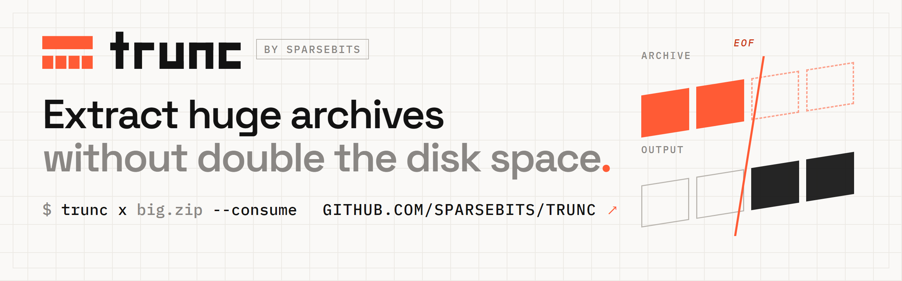
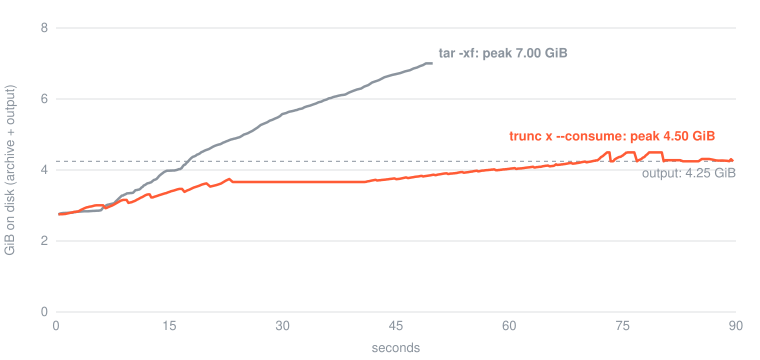

<p align="center">
  <picture>
    <source media="(prefers-color-scheme: dark)" srcset="docs/assets/banner-dark.png">
    
  </picture>
</p>

<p align="center"><b>Unpack archives that are bigger than your free space.</b></p>

<p align="center">
  <a href="https://github.com/Sparsebits/trunc/actions/workflows/ci.yml"></a>
  <a href="#license"></a>
  
  
</p>

<p align="center">
  <a href="#installation">Installation</a> ·
  <a href="#usage">Usage</a> ·
  <a href="#supported-formats">Formats</a> ·
  <a href="#faq">FAQ</a> ·
  <a href="#how-it-works">How it works</a> ·
  <a href="docs/guide.md">User guide</a>
</p>

---

trunc extracts an archive and deletes it as it goes, so you need room for the contents, not
the contents plus the archive.

<p align="center">
  
</p>

<p align="center"><sub>A 2.76 GiB ZIP into 4.25 GiB of files: <code>tar -xf</code> peaks at 7.00 GiB, <code>trunc x --consume</code> at 4.50 GiB.</sub></p>

<details>
<summary>How this was measured</summary>

702 files (a 1 GiB video, photos, a 1 GiB CSV and logs). The line is the space allocated to the
archive and the extracted files, read every 100 ms with `GetCompressedFileSizeW`, so freed parts
of the archive count as free. One run each, NTFS on a Samsung NVMe SSD, AMD Ryzen 7 5800H. The
sampling slowed both runs, so the time axis is stretched.

</details>

```console
$ trunc x dataset.zip -C dataset --consume --yes
extracted 702 files, 5 directories, 4.25 GiB into dataset
archive   consumed and removed
```

## Highlights

- **Works on the archives you have:** ZIP, `.tar` and `.tar.gz`/`.bz2`/`.xz`/`.zst`, ISO, 7z,
  single compressed files and split archives.
- **Less space:** about *output minus archive*, even inside a single 50 GB file.
- **Safe to interrupt:** nothing is freed until its output is verified and on disk; `trunc resume`
  picks up after a crash, a kill or a full disk.
- **Plans first:** `trunc plan` shows the space each mode needs before anything changes.
- **Fast:** bzip2, multi-block xz, multi-frame zstd and BGZF gzip decode on all cores.
- **Windows and Linux:** x64 and ARM64; the Linux builds are static.

## Installation

```sh
# Linux
curl -LsSf https://raw.githubusercontent.com/Sparsebits/trunc/main/install.sh | sh
```

```powershell
# Windows
powershell -ExecutionPolicy ByPass -c "irm https://raw.githubusercontent.com/Sparsebits/trunc/main/install.ps1 | iex"
```

The scripts verify the download's SHA-256 (and its [build provenance](docs/security.md#verifying-downloads)
if the GitHub CLI is installed). Set `TRUNC_VERSION` to pin a version or `TRUNC_INSTALL_DIR` to
choose where it goes. You can also grab a [release](https://github.com/Sparsebits/trunc/releases)
or run `cargo install --git https://github.com/Sparsebits/trunc trunc-cli`.

## Usage

```sh
trunc plan big.zip -C out               # how much space each mode needs; changes nothing
trunc x big.zip -C out --consume        # extract, deleting the archive as it goes (asks first; --yes skips)
trunc x big.tar.zst -C out --consume    # tarballs, ISO images and split parts work the same way
trunc x disk.img.xz --consume           # a single compressed file: leaves disk.img
trunc resume big.zip                    # continue after a crash, a kill or a full disk
trunc x big.zip -C out                  # without --consume: an ordinary extractor
```

`trunc inspect` lists what's inside and `trunc verify` checks every checksum without writing.
See `trunc <command> --help` or the [user guide](docs/guide.md#commands-and-options) for every
option, including container images and trunc's own `.trnc` format.

## Supported formats

| Format | Extract | `--consume` | Space comes back |
|---|---|---|---|
| ZIP (Stored, Deflate, bzip2, zstd, xz, Zip64) | yes | yes | after each group of entries, and every 64 MiB inside big entries |
| `.tar.gz`, `.tar.bz2`, `.tar.xz`, `.tar.zst` and single `.gz`/`.bz2`/`.xz`/`.zst` files | yes | yes | every 64 MiB of output |
| ISO 9660 images, uncompressed `.tar` | yes | yes | as for ZIP |
| Compressed archives split into `.001` or `.aa` parts | yes | yes | as above, and each part is deleted once its data is safe |
| 7z | yes | not yet | — |
| Container images (`docker save`, OCI) | yes | no | — |
| `.trnc` | yes | yes | after each batch of blocks |

Freeing space inside a file needs NTFS, ext4, XFS, btrfs or ZFS; elsewhere compressed archives
give their space back at the end. Details for each format are in the
[user guide](docs/guide.md#supported-formats).

## How it works

trunc frees a piece of the archive only after the files it held are verified and flushed to
disk, so every byte is always either still in the archive or already in place. Its own `.trnc`
format stores blocks back to front, so it shrinks from the end:

```text
┌────────┬──────────┬─────────┬─────────┬─────────┐
│ header │ manifest │ block 3 │ block 2 │ block 1 │  ──►  files from block 1
└────────┴──────────┴─────────┴─────────┴─────────┘
                                          ▲  cut here once those files are on disk
```

ZIP files, ISO images and plain tar archives are shortened from the end too. Compressed streams
are read from the start, so trunc frees the bytes it has already decoded from inside the file,
every 64 MiB of output. For these formats it scans the whole archive first and keeps a small
journal next to it. The [user guide](docs/guide.md#what---consume-does) has the details.

## Safety

- Every piece is checked against its hash, CRC or codec checksum before its source is freed.
- The test suite crashes an extraction at every filesystem operation, including torn writes and
  full disks, and checks that recovery gives exactly the right files.
- Output goes to a staging folder and appears all at once; `--consume` never overwrites files.
- Hostile paths can't leave the destination, and links are never followed when writing.
- trunc refuses to consume in cloud-synced folders or on unjournaled filesystems unless told to.

The [security checklist](docs/security.md) maps each rule to the code and test that enforce it.

## When not to use it

- **You want to keep the archive:** leave off `--consume`.
- **The archive is in a cloud-synced folder:** the client would upload every change.
- **The disk keeps snapshots:** a snapshot holds on to the space trunc frees.
- **The drive is FAT32 or exFAT:** these can lose their own records in a crash.

## FAQ

**How much free space do I need?** About *output minus archive*, plus some working room, when
both are on the same volume. `trunc plan <archive> -C <destination>` gives a conservative figure
for your archive and filesystem.

**What happens if my computer crashes halfway?** Run `trunc resume <archive>`. Finished files were
on disk before their part of the archive was deleted; everything else is still in the archive.

**What if the disk fills up anyway?** trunc pauses with exit code 75 and keeps what it needs to
resume. Free some space and run `trunc resume <archive>`.

**Can other tools still open the archive afterwards?** Not once a consume has started; trunc says
so before it begins. Without `--consume` the archive is untouched.

## Performance

Extracting a 10 GiB folder from a 5.81 GiB `.trnc` archive on NTFS (Ryzen 7 5800H, NVMe):

| Command | Peak extra space | trunc's prediction | Time |
|---|---|---|---|
| `trunc x --consume` | **4.32 GiB** | 4.39 GiB | 53 s |
| `trunc x` | 10.00 GiB | 10.07 GiB | 60 s |

This is space needed beyond the archive already on disk; the chart above shows the total. See
the [measurement notes](docs/spec/invariants.md#measured-10-gib-ntfs).

Add `--profile run.json` to any command to see where the time goes; the user guide explains
[parallel decoding](docs/guide.md#parallel-decoding) and [how to read a profile](docs/guide.md#performance-and-profiling).

## Documentation

- [User guide](docs/guide.md): format details, commands, options, recovery and profiling
- [Security checklist](docs/security.md): archive validation, known limits and download verification
- [Format spec](docs/spec/trnc-format-v1.md): the `.trnc` v1 file format
- [Crash-safety invariants](docs/spec/invariants.md): what must hold after any crash, and the test
  for each
- [Design decisions](docs/adr): why trunc works the way it does
- [Changelog](CHANGELOG.md)

## Platform support

Windows (NTFS) and Linux (ext4, XFS, btrfs, ZFS) get every feature. CI tests both on x64 and
cross-compiles for ARM64; releases cover x64 and ARM64 on both, and the Linux builds are static.

FAT32 and exFAT drives work with `--allow-unjournaled`. On filesystems that can't free space inside
a file, compressed tarballs still consume safely but give their space back only at the end, and a
large ZIP entry only once it is finished. macOS is untested.

## Contributing

Issues and pull requests are welcome. Before opening a PR, please run `cargo fmt --check`,
`cargo clippy --workspace --all-targets -- -D warnings` and `cargo test --workspace`. If you change
how archives are consumed, add a crash test; `crates/trunc-engine/tests/consume.rs` has examples.

To build, you need Rust 1.85 or newer, plus the MSVC build tools on Windows:

```sh
cargo build --release      # target/release/trunc
cargo test --workspace
```

The parsers are fuzzed with [cargo-fuzz](https://github.com/rust-fuzz/cargo-fuzz). On Linux with
a nightly toolchain, run `cargo +nightly fuzz run zip` (the targets are `zip`, `tar`,
`inflate`, `bzip2`, `xz`, `zstd`, `manifest`, `header` and `footer`).

<details>
<summary><b>Repository layout</b></summary>

| Path | What |
|---|---|
| `crates/trunc-core` | File format types, path rules, space model. No I/O. |
| `crates/trunc-hash` | BLAKE3, CRC32C, SHA-256 |
| `crates/trunc-codec` | zstd, lz4 and uncompressed blocks |
| `crates/trunc-chunk` | Splitting content into blocks |
| `crates/trunc-fs` | Filesystem access: sparse files, file ids, volume checks, cloud-sync detection |
| `crates/trunc-journal` | The crash-safe journal used when consuming ZIP files and compressed archives |
| `crates/trunc-legacy` | ZIP, tar, ISO and 7z readers, split archives, and the resumable Deflate, bzip2, xz and zstd decoders |
| `crates/trunc-engine` | Creating, extracting, verifying and consuming archives |
| `crates/trunc-cli` | The `trunc` command |
| `crates/trunc-prof` | The span profiler behind `--profile` |
| `crates/trunc-testkit` | A simulated filesystem that can crash on demand, plus test fixtures |
| `crates/flavors/`, `flavors/` | Tools built on trunc: weightdrop, layerless, ci-restore |
| `fuzz/` | Fuzz targets |

</details>

## Built on trunc

- [weightdrop](crates/flavors/weightdrop/): unpack sharded model weights and datasets on GPU
  boxes with small disks.
- [layerless](crates/flavors/layerless/): pull a container image straight to a root filesystem,
  with no tarball and no daemon.
- [ci-restore](flavors/ci-restore/): restore big CI caches and artifacts without doubling runner
  disk.

## License

Licensed under either of [Apache License, Version 2.0](LICENSE-APACHE) or [MIT license](LICENSE-MIT),
at your option.

Unless you explicitly state otherwise, any contribution you intentionally submit for inclusion
in this work, as defined in the Apache-2.0 license, shall be dual licensed as above, without any
additional terms or conditions.

<p align="center"><sub>Made by <a href="https://github.com/Sparsebits">Sparsebits</a>.</sub></p>
